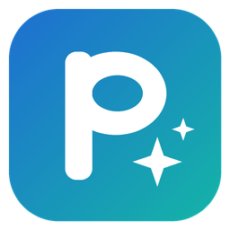

# Purgely – the ultimate PC tool

*by KraljForge Labs – Practical tools forged for the future.*

One free tool for Windows 11 that keeps a PC clean and up to date: uninstall programs and Store apps completely,
clean leftovers and installer junk, remove bloatware and Windows ads, update programs and drivers, and control
startup. Every item comes with a plain explanation, almost everything can be undone, and there are no ads.

> **Public beta (0.9).** Purgely works and is tested, but it hasn't met many PCs yet. Please read [BETA.md](BETA.md)
> and tell us what you find.

## Download
1. Open **[Releases](https://github.com/kraljforgelabs/Purgely/releases)** and download `Purgely.exe` (it's a single file,
   nothing to install).
2. Optional: check the download. `SHA256SUMS.txt` next to it lists its fingerprint, and
   `Get-FileHash Purgely.exe` in PowerShell must show the same value.
3. Start it. Windows asks for administrator rights. Because Purgely isn't code-signed yet, Windows may show
   "Windows protected your PC" – click *More info → Run anyway*.

The [user guide (PDF)](docs/Purgely-User-Guide.pdf) explains every feature. Website:
https://kraljforgelabs.github.io/Purgely/

## Features (0.9)
- **Home screen** with ten live tiles, a Notices panel, **Checkup** (one look at the whole PC, fixes only what is certain) and
  **Move to new PC** (save your program list, reinstall everything on the new PC with winget)
- **Uninstall** – desktop programs, Microsoft Store apps and portable programs; **several at once** (quiet mode where the
  uninstaller allows it, one combined leftover scan); live uninstall window, force uninstall; deep leftover scan with
  confidence shown in words and known-program rules; suite cleanup; smart suggestions (unused for months, duplicates)
- **Clean leftovers** – removed programs and a whole-PC sweep for orphaned shortcuts, tasks, services and empty folders
- **Installer junk**, **Dependency Map**, **PC Timeline** with Bundleware Detector
- **Bloatware, ads, AI & privacy** – preinstalled apps with a verdict; ads and suggestions; Recall, Click to Do, Copilot;
  optional diagnostic data, typing data, activity history; **browser extensions** with what they may do and where they
  came from; Purgely tells you when Windows brings something back
- **Install & Track** – checks an installer first (signature, download source, bundled offers, VirusTotal lookup),
  records everything it changes, and undoes it completely later
- **Updates** (winget, hidden, with progress) and **Drivers** (signed only – Microsoft Update Catalog or the PC maker)
- **Startup** manager and **Undo center** for everything Purgely changed
- **Leftover registrations** *(0.9)* – right-click menu entries, file types, Win+R paths, firewall rules and PATH entries
  that point into a removed program's folder
- **Repair** *(0.9.1)* – devices that don't work, devices that aren't connected any more, no sound, no internet, and
  missing Microsoft runtimes ("a DLL is missing") using only Windows' own tools and official packages
- **Epic Games games** *(0.9.2)* – listed with your other programs; uninstalled through the Epic launcher, then scanned
  for leftovers
- **Uninstall by icon** *(0.9.2)* – drop a program's icon on Purgely, drag **Find by window** onto its window, or use
  the optional **Uninstall with Purgely** right-click entry
- **Settings** *(0.9)* – update check (once a day, never downloads anything by itself), Timeline history, Undo storage,
  welcome tour, and **Remove Purgely and its data**
- **Open knowledge base** – `src/Purgely/Knowledge/*.json`, see `CONTRIBUTING.md`

## Code signing
Releases are **not code-signed yet**, so Windows SmartScreen may warn about an unknown app. Every release is built by
GitHub Actions from this repository – never on someone's PC – and comes with `SHA256SUMS.txt`, so you can check that
the file you downloaded is exactly the one GitHub built (`Get-FileHash .\Purgely.exe` in PowerShell).

## Trust
Releases are built by GitHub Actions from this source (`.github/workflows/release.yml`) with SHA-256 checksums. Nobody
builds them by hand. Code signing is planned once the project is better known (`SIGNING.md`); a winget listing will follow with 1.0
(`packaging/winget`).

Quality: every risky change goes through the council (`D:\AI\council`) and `preflight.bat`.

## For developers

### Build and check
Requirements: .NET 10 SDK.

- `build.bat` – publishes `dist\Purgely.exe` and starts it (asks for administrator rights).
- `preflight.bat` – Release build + unit tests + safety audit. It must finish with no **MUST FIX** before testing.
- `tools\safety-audit.ps1 -UpdateBaseline` – only after the council has reviewed new destructive calls.
- `sandbox.bat` – opens Purgely in Windows Sandbox with a fake removed program ("Contoso PhotoTool") and traps
  that must survive (your Documents, a junction, another installed Contoso program). After cleaning, run
  `C:\PurgelyTest\check-after-clean.ps1` in the sandbox; the report lands in `sandbox-results\`.
- `test-on-this-pc.bat` – the same trap test on the real PC when Sandbox can't run (restore point first, fake programs
  only, traps point at dummy folders, option 4 removes exactly what it planted). Includes the ads & suggestions
  before/after/Undo check.
- `publish-to-github.bat` – uploads the source to GitHub; GitHub Actions (`.github/workflows/ci.yml`) then builds, tests
  and audits every change on a real Windows machine.
- `make-release.bat` – tags the version from `Purgely.csproj`; `.github/workflows/release.yml` builds `Purgely.exe`,
  checksums and the release (versions before 1.0 are marked *Pre-release*).

### Layout
- `src/Purgely/Core` – engine (inventory, uninstall, scanning, scoring, Undo, Trial Mode, startup)
- `src/Purgely` – WPF user interface (`HomeWindow` is the start screen)
- `tests/Purgely.Tests` – safety regression tests
- `tools` – safety audit and its baseline
- `AGENTS.md` – rules for anyone (human or AI) changing the code

## Privacy and security
Purgely collects and sends nothing about you – see `PRIVACY.md`. Report security problems privately – see `SECURITY.md`.

## Trademarks
Purgely is an independent project and is not affiliated with, endorsed by or sponsored by any company or product it
mentions or detects (for example Microsoft, Autodesk, Intel, NVIDIA or other publishers). Product and company names
are trademarks of their respective owners and are used only to identify software installed on your PC.

## License
MIT – see [LICENSE](LICENSE). Copyright (c) 2026 KraljForge Labs.

Purgely is free and has no ads. It is provided "as is", without warranty. It changes your PC only after you confirm,
and almost everything can be undone from the Undo center.
